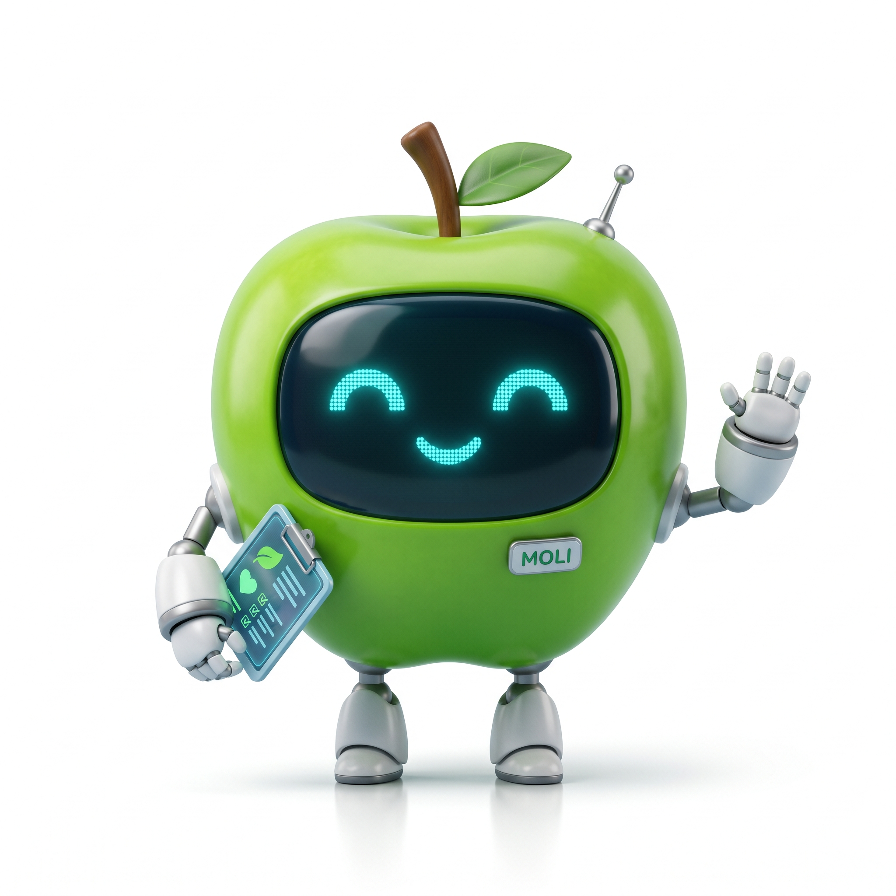
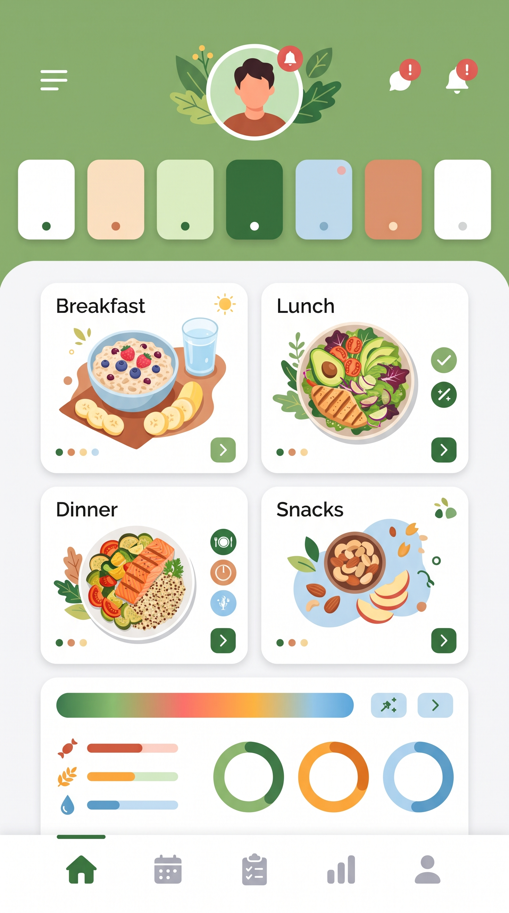

# 🍏 Data Bite: Nutrición Impulsada por Datos (Molinos Innova)

Propuesta de producto de datos desarrollada para el concurso **Molinos Innova**. 

Este proyecto une el rigor de la nutrición con la capacidad de la ciencia de datos para generar un impacto preventivo y real en la salud de los usuarios a través de la tecnología.

## 📱 Vista Previa del Producto & UI

| Asistente Virtual (Moli) | Prototipo de Interfaz Mobile |
| :---: | :---: |
|  |  |

## 🎯 Visión del Producto
Data Bite transforma la planificación alimentaria combinando el catálogo de productos Molinos con sistemas de recomendación e inteligencia artificial. 

El núcleo de la experiencia es **Moli**, un asistente virtual que guía al usuario mediante la entrega de planes de comida semanales adaptados a sus requerimientos nutricionales.

## 🏗️ Estructura del Repositorio
* **[`docs/ StartSe AI Canvas`](./docs/StartSe_AI_Canvas.md)**: Documentación estratégica del proyecto ([Ver Canvas en StartSe](https://ai-canvas.startse.com/?projectId=6ae31c498e32623e3697c822)).
* **`moli-mascot.jpg` & `app-mockup.jpg`**: Prototipos visuales y mockups de la interfaz mobile.
* **`data/`**: (Proyectado) Estructuración del catálogo de productos Molinos e información nutricional.

## 💡 Valor Diferencial y Product Sense
1. **Gamificación Estratégica:** Aumenta la retención (*engagement*) a través de interacciones dinámicas con el asistente Moli.
2. **Decisiones Basadas en Datos:** Transforma métricas biométricas y nutricionales en listas de compras automatizadas.
3. **Impacto Comercial Integrado:** Posiciona de manera orgánica el portafolio de productos Molinos dentro del estilo de vida del consumidor.
